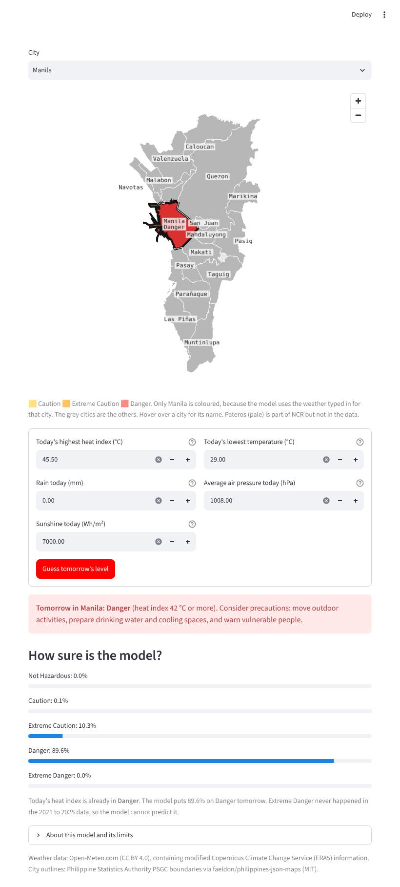
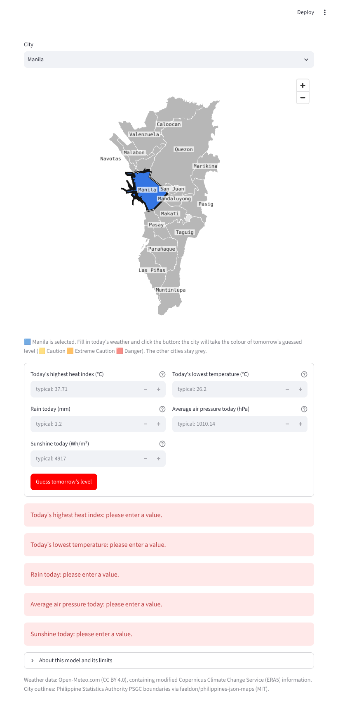

# 1. What the project does

HeatCast NCR predicts the level of tomorrow's highest heat index in one of the 16 cities of the National Capital Region (Metro Manila), using
today's weather in that city. The answer is one of the five PAGASA levels: Not Hazardous (below 27 °C), Caution (27 to below 33 °C),
Extreme Caution (33 to below 42 °C), Danger (42 to below 52 °C) and Extreme Danger (52 °C and above).

Three traditional algorithms were compared on the same chronological split and the same five time-ordered folds: Logistic Regression,
Random Forest and Gradient Boosting. The selected model is a Random Forest (maximum depth 12, at least 5 days per leaf, balanced class weights,
500 trees, random state 42). It is deployed as a Streamlit application:

* Live application: <https://heatcast-ncr.streamlit.app/>
* Repository: <https://github.com/keyyum/heatcast-ncr-simple>

The application is a decision aid for schools, employers of outdoor workers and city offices. It is not a PAGASA advisory.

# 2. Installation

Requirements: Python 3.11 to 3.14 and an internet connection for the first installation. Tested in a clean Python 3.11 environment and with Python 3.13.

```bash
git clone https://github.com/keyyum/heatcast-ncr-simple
cd heatcast-ncr-simple
python -m venv .venv
source .venv/bin/activate              # Windows: .venv\Scripts\activate
pip install -r requirements.txt
```

`requirements.txt` lists exact versions. They matter for the saved model: `models/heatcast_random_forest.joblib` must be read with the
scikit-learn version it was saved with (1.9.1).

| Package | Version | Used for |
|---|---|---|
| pandas | 3.0.5 | tables |
| numpy | 2.4.6 | numbers |
| scikit-learn | 1.9.1 | the three models, preprocessing, folds and scores |
| joblib | 1.6.0 | saving and loading the model |
| matplotlib | 3.11.2 | figures in the notebooks |
| seaborn | 0.13.2 | figures in the EDA notebook |
| streamlit | 1.65.0 | the application |
| pydeck | 0.9.3 | the map in the application |

# 3. Folder structure

| Folder or file | Contents |
|---|---|
| `app/` | the Streamlit application (`streamlit_app.py`), its logic (`app_logic.py`), the city outlines and locations, and `sample_inputs_outputs.py` |
| `data/original/` | the original dataset (64,240 rows, 26 columns, 2015 to 2025), its data dictionary and `SOURCE.md` (source, licence, collection) |
| `data/processed/` | `ncr_city_daily.csv`, the dataset used by the models (29,168 rows, 8 columns, 2021 to 2025) |
| `notebooks/` | `01_eda`, `02_logistic_regression`, `03_random_forest`, `04_gradient_boosting`, `05_final_test` |
| `src/` | `make_dataset.py` (original to processed data), `common.py` (split, folds, preprocessing, scores), `final_model.py` (saves the selected model), `compare_models.py` (the three models side by side) |
| `models/` | `heatcast_random_forest.joblib`, the saved pipeline (preprocessing and Random Forest) that the application loads |
| `results/` | scores, tables and figures of each notebook and script (`eda/`, `random_forest/`, `comparison/`, `final_test/`) |
| `tests/` | 75 automatic checks: 24 for the data and shared code, 51 for the application |
| `documentation/` | this document, the data dictionary, a plain-language guide, sample inputs and outputs, and screenshots |
| `paper/` | the final paper (DOCX and PDF) |
| `requirements.txt` | exact package versions |

# 4. Running the project

All commands run from the project folder.

| Step | Command | Time |
|---|---|---|
| Rebuild the processed dataset (optional, it is included) | `python src/make_dataset.py` | seconds |
| Exploratory data analysis | open `notebooks/01_eda.ipynb` and run all cells | under a minute |
| Train and tune each model | run notebooks `02`, `03` and `04` | a few minutes each |
| Compare the three selected settings on the same folds | `python src/compare_models.py` | about a minute |
| Final test (done once; do not use it to choose anything) | `notebooks/05_final_test.ipynb` | under a minute |
| Save the selected model | `python src/final_model.py` | about 5 seconds |
| Start the application | `streamlit run app/streamlit_app.py` (opens <http://localhost:8501>) | seconds |
| Run all tests | `python -m unittest discover -s tests -v` | about 30 seconds |
| Sample inputs and outputs | `python app/sample_inputs_outputs.py` | seconds |

Every random step uses random state 42. The split is chronological: training days 2021-01-01 to 2024-12-27 (23,312 rows), one day skipped,
test days 2024-12-29 to 2025-12-28 (5,840 rows). Preprocessing is fitted inside each pipeline on the training days of each fold only.

# 5. Input format

The application asks for one city and five numbers about **today** in that city.

| Input | Unit | Accepted (hard limit) | Range in the training days | Meaning |
|---|---|---|---|---|
| City | name | one of the 16 cities | 16 cities | Caloocan, Las Piñas, Makati, Malabon, Mandaluyong, Manila, Marikina, Muntinlupa, Navotas, Parañaque, Pasay, Pasig, Quezon, San Juan, Taguig, Valenzuela |
| Today's highest heat index | °C | 10 to 60 | 26.13 to 47.63 | the highest "feels-like" temperature of the day |
| Today's lowest temperature | °C | 10 to 40 | 22.0 to 30.0 | roughly how warm the night was |
| Rain today | mm | 0 to 500 | 0 to 175.1 | total rain of the day; 0 means a dry day |
| Average air pressure today | hPa | 950 to 1050 | 995.2 to 1019.3 | mean sea-level pressure; low values go with storms |
| Sunshine today | Wh/m² | 0 to 10,000 | 478 to 7,551 | total solar radiation of the day |

A value outside the hard limit is refused. A value inside the hard limit but outside the training range is accepted with a warning that the
prediction is less reliable. A value on a limit (for example 0 mm or 500 mm of rain) is accepted.

# 6. Application guide

1. Choose the city at the top. It is highlighted in blue on the map.
2. Type today's five weather values. The boxes start empty; a box left empty is reported, never filled in silently.
3. Click **Guess tomorrow's level**.
4. Read the result: the predicted level for tomorrow, the probability of each of the five levels, the level of today's heat index, and the map with
   the city in the colour of the predicted level (yellow Caution, orange Extreme Caution, red Danger).
5. Open **About this model and its limits** for the model, its test results and what it cannot do.

{width=45%} {width=45%}

Sample inputs and the application's answers (from `documentation/sample_inputs_outputs.csv`):

| Type | Case | City | Heat index (°C) | Min. temp. (°C) | Rain (mm) | Pressure (hPa) | Sunshine (Wh/m²) | Output |
|---|---|---|---|---|---|---|---|---|
| Valid | normal dry day | Manila | 38.0 | 26.0 | 0 | 1010 | 5000 | Extreme Caution (90%) |
| Valid | very hot sunny day | Manila | 45.5 | 29.0 | 0 | 1008 | 7000 | Danger (90%) |
| Valid | cool rainy day | Quezon | 29.0 | 24.0 | 90 | 1003 | 1500 | Caution (55%) |
| Valid | hot day in a hot city | Malabon | 42.0 | 27.5 | 0 | 1010 | 6500 | Danger (87%) |
| Boundary | rain at the upper limit | Pasig | 38.0 | 26.0 | 500 | 1010 | 5000 | Extreme Caution (79%), with a warning |
| Boundary | heat index above the data maximum | Manila | 55.0 | 26.0 | 0 | 1010 | 5000 | Danger (54%), with a warning |
| Invalid | negative rain | Manila | 38.0 | 26.0 | -5 | 1010 | 5000 | error: "Accepted values are 0 to 500 mm" |
| Invalid | impossible heat index | Manila | 200 | 26.0 | 0 | 1010 | 5000 | error: "Accepted values are 10 to 60 °C" |
| Invalid | pressure left empty | Manila | 38.0 | 26.0 | 0 | (empty) | 5000 | error: "please enter a value" |
| Invalid | text instead of a number | Manila | 38.0 | "warm" | 0 | 1010 | 5000 | error: "not a number" |
| Invalid | city outside the data | Cebu | 38.0 | 26.0 | 0 | 1010 | 5000 | error: "Choose one of the 16 cities" |

# 7. The model inside the application

The application loads `models/heatcast_random_forest.joblib`, one scikit-learn pipeline with two steps: the preprocessing (`make_preprocess(scale=False)`:
the five weather numbers unchanged, the city as 16 yes/no columns) and the Random Forest. `src/final_model.py` fits it on the training days and saves it;
running it again gives the same file byte for byte. It is the model that `notebooks/05_final_test.ipynb` evaluated once on the test days, and a test
(`tests/test_app.py`, `SavedModel`) checks that the saved file gives exactly those results.

| Scores | Random Forest | "Copy today" rule |
|---|---|---|
| Macro F1 over Caution, Extreme Caution and Danger, five folds | 0.653 ± 0.039 | 0.679 ± 0.051 |
| Macro F1, test days | 0.614 | 0.675 |
| Accuracy, test days | 0.731 | 0.824 |
| Danger recall, test days | 0.844 (293 of 347) | 0.597 (207 of 347) |
| Danger precision, test days | 0.359 (293 of 816) | 0.597 |

# 8. Model limitations

* It does not beat the simple rule "tomorrow's level is today's level" on overall score; it only catches more Danger days, at the cost of many false
  Danger warnings (about 2 in 3 of its Danger warnings were wrong on the test days).
* The weather values and labels are ERA5 reanalysis estimates (about 25 km grid), not PAGASA station readings, and the label is not an official advisory.
* The 16 cities fall in only two ERA5 grid cells, so rain, pressure and sunshine are shared by many cities.
* Not Hazardous (40 rows) and Extreme Danger (none) are too rare to learn; the model will practically never predict them.
* Only today's five values are used: no month, no trend over several days, no weather forecast, so a storm that is still coming is not seen.
* Danger is seasonal and differs from year to year (4.4% of rows in 2022, 15.7% in 2024), so scores for Danger vary between years.

# 9. Troubleshooting

| Problem | Cause | Fix |
|---|---|---|
| `pip install` fails on numpy or pandas | Python older than 3.11 | install Python 3.11 or newer and create the virtual environment again |
| The page shows "The saved model file could not be read" | the model file is missing, or scikit-learn is not version 1.9.1 | run `pip install -r requirements.txt`, then `python src/final_model.py`; the page still works meanwhile (it trains the same model, about 5 seconds) |
| `ModuleNotFoundError: common` in a notebook | the notebook was not started from `notebooks/` | open the notebook from the `notebooks/` folder, or run `sys.path.append("../src")` first |
| `streamlit: command not found` | the virtual environment is not active | activate it, or run `python -m streamlit run app/streamlit_app.py` |
| The map shows outlines but no street map | no internet connection | nothing to fix: the outlines and the prediction work offline |
| The live application shows an error right after an update | Streamlit Community Cloud kept an old copy of the code in memory | open the app, then Manage app, Reboot app, and wait about a minute |
| A number box refuses a value | it is outside the hard limit (Section 5) | check the unit (for example hPa, not kPa) |

# 10. Data and licences

Weather data: Open-Meteo Historical Weather API (CC BY 4.0, non-commercial use), containing modified Copernicus Climate Change Service (ERA5) information.
City list: Philippine Statistics Authority PSGC via the `psgc` package (MIT); city coordinates from OCHA/HDX boundaries (CC BY-IGO).
City outlines in the application: PSGC 2023 boundaries from faeldon/philippines-json-maps (MIT). Details: `data/original/SOURCE.md` and
`documentation/data_dictionary.md`.
